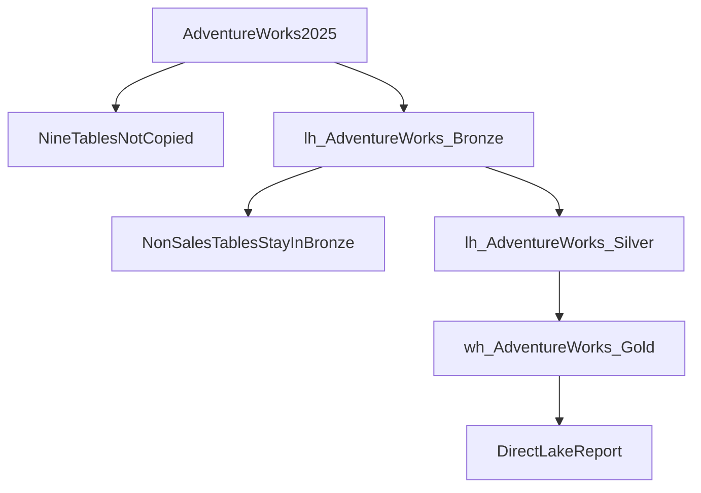
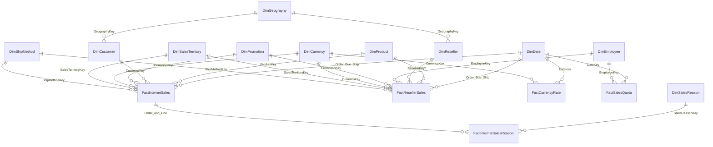

# Part 1 — Architecture

`AdventureWorks2025` loads into Fabric. `AdventureWorksDW2025` is the Gold shape and is not a source. Database CDC stays on, with no tables captured. Do not restore the OLTP database.

## Names

- Workspace: the existing empty trial workspace. Preferred name `ws_AdventureWorks` only if it does not already have one.
- `lh_AdventureWorks_Bronze`, schema-enabled. Schemas match the source.
- `lh_AdventureWorks_Silver`, schema-enabled. Entities in `cleansed`. Logs in `etl`. No `Silver_` prefix.
- `wh_AdventureWorks_Gold`. Star tables, `dbo.ETL_Log`, `dbo.ingest_watermark`, and `dbo.usp_Load_Gold`.
- Pipeline `pl_AdventureWorks_Medallion`. Notebook `nb_silver_load`. Semantic model and report come in a later turn.
- Gateway connection: the existing `fabric_user` connection. No credentials in this repo.

Banned names, none of which exist in the 2025 OLTP extract: `Person.Contact`, `Sales.Individual`, `CustomerAddress`, `EmployeeAddress`, `StoreContact`, `VendorContact`, `ContactCreditCard`, `Employee.ManagerID`, and `Sales.Customer.CustomerType`. `Person.ContactType` is a real table and is not a Gold input.

## Ingestion

`pl_AdventureWorks_Medallion` runs a Lookup of [ingest_control.sql](../sql/source/ingest_control.sql) against SQL Server through the gateway, then a ForEach with one Copy activity. Batch count 4. Stop on the first failure. Retry 2, 30 seconds, timeout 15 minutes. No staged copy and no partitioned copy.

Parameters: `RunMode` (`Full` or `Incremental`, default `Full`), `WatermarkOverride` (empty), `CoreOnly` (default false). Manual trigger. Do not schedule it.

`Full` uses sink Overwrite. `Incremental` adds `ModifiedDate` greater than the watermark and uses sink Upsert on the primary key, and only for `Sales.SalesOrderHeader` and `Sales.SalesOrderDetail`. A missing watermark falls back to Overwrite. The watermark lives in `wh_AdventureWorks_Gold.dbo.ingest_watermark`. After a successful Gold load, it is set to `MAX(ModifiedDate)` for those two tables.

The Copy source query is the `source_query` column from the control query. The watermark predicate is appended by the pipeline. It is not baked into the control query.

## Bronze

69 base tables. These nine are absent from the Lookup result:

- `cdc.captured_columns`, `cdc.change_tables`, `cdc.ddl_history`, `cdc.index_columns`, `cdc.lsn_time_mapping`
- `dbo.AWBuildVersion`, `dbo.sysdiagrams`, `dbo.systranschemas`
- `Person.Password`

The control query serializes types and does not apply business rules:

- `geography`: `.STAsText()` plus `.STSrid` in a second column
- `hierarchyid`: `.ToString()`
- `xml`: `CAST` to `nvarchar(max)`
- `varbinary`, `binary`, and `image`: not selected
- alias types: `CAST` to the base type from `sys.types`
- `sysname`: `CAST` to `nvarchar(128)`
- `rowversion` / `timestamp`: `CAST` to `varbinary(8)`
- computed columns: selected as stored values

`CardNumber`, `NationalIDNumber`, `LoginID`, and `BirthDate` land in Bronze and are dropped in Silver. Purchasing, work orders, inventory, and the rest of HR stay in Bronze.

`is_core = 1` marks the Silver inputs. `Person.BusinessEntityAddress`, `Person.AddressType`, `Person.PhoneNumberType`, `Sales.SalesReason`, and `Sales.SpecialOfferProduct` are core even though they are not Gold tables. Geography, phone, sales reason, and the detail-to-offer foreign key cannot be built without them.

## Silver

One Runtime 2.0 notebook. Native Execution Engine on. V-Order on for Silver writes. No partitioning, Z-order, or liquid clustering.

`cleansed.Date` is a generated calendar. `SalesOrderLineNumber` is assigned here.

`etl.quarantine`, `etl.dq_result`, and `etl.load_log` record rejects, checks, and row counts. A core-table quarantine row or a failed grain assertion stops the pipeline before Gold.

## Gold

`dbo.usp_Load_Gold` writes every Gold table in one transaction. Primary keys and foreign keys are declared `NOT ENFORCED`. The load rejects duplicate keys. The unknown member is `-1`.

- `DimDate`: `DateKey` is `YYYYMMDD`. Order date is the active relationship.
- `DimProduct`: subcategory and category names on the product row. Unit cost is `ProductCostHistory` as of `OrderDate`, otherwise `Product.StandardCost`.
- `DimCustomer`: `Sales.Customer` where `StoreID` is null.
- `DimReseller`: `Sales.Store`.
- `DimEmployee`: employee plus person name. National ID, login, and birth date are dropped.
- `DimPromotion`: `Sales.SpecialOffer`. `PromotionKey` comes from `SalesOrderDetail.SpecialOfferID`.
- `DimSalesReason`: `SalesReasonKey`, `SalesReasonAlternateKey` = `SalesReasonID`, name, and reason type.
- `DimSalesTerritory`: `Sales.SalesTerritory`.
- `DimGeography`: distinct city, state, and country. Customer and reseller hold `GeographyKey`.
- `DimCurrency`: `Sales.Currency`.
- `DimShipMethod`: `Purchasing.ShipMethod`.
- `FactInternetSales`: `OnlineOrderFlag = 1`. Primary key `(SalesOrderNumber, SalesOrderLineNumber)`.
- `FactResellerSales`: `OnlineOrderFlag = 0`. Same primary key. Uses `ResellerKey` and `EmployeeKey`.
- `FactInternetSalesReason`: primary key `(SalesOrderNumber, SalesOrderLineNumber, SalesReasonKey)`. Each header reason is stamped onto every line of that internet order.
- `FactCurrencyRate`: primary key `(CurrencyKey, DateKey)`.
- `FactSalesQuota`: `SalesQuotaKey`, from `Sales.SalesPersonQuotaHistory`.

`UnitPriceDiscount` is a rate. `DiscountAmount = UnitPrice * OrderQty * UnitPriceDiscount`. `SalesAmount` is recomputed as `decimal(19,4)`. `TotalProductCost = unit cost * OrderQty`.

`TaxAmt` and `Freight` are allocated to lines by each line's share of header `SubTotal`. The sum of the lines must equal the header. A zero subtotal keeps both amounts on the first line.

A null `CurrencyRateID` maps to USD only after a query shows those orders are USD. Until that query passes, the rows go to `etl.quarantine`.

`SalesOrderDetailID` is stored on the line facts and hidden in the semantic model. `OnlineOrderFlag` versus `StoreID` mismatches are logged and do not fail the load until the rate is measured.

Not built: `FactFinance`, `FactCallCenter`, `FactSurveyResponse`, and a daily `FactProductInventory`. OLTP `ProductInventory` has 1,069 rows. The warehouse backup has 776,286.

`dbo.ETL_Log` and `dbo.ingest_watermark` are not in the semantic model.

## Pipeline order

1. Lookup `ingest_control.sql`.
2. Lookup `dbo.ingest_watermark` when `RunMode` is `Incremental`.
3. Filter when `CoreOnly` is true.
4. ForEach Copy into Bronze.
5. `nb_silver_load`. A failed DQ gate stops the pipeline.
6. GA `refreshMetadata` on the Silver SQL analytics endpoint, then poll.
7. `EXEC dbo.usp_Load_Gold`.
8. Semantic model refresh. Direct Lake on OneLake. `DimDate` is the date table.

The steps after Bronze are later turns. This turn writes the control query and these docs only.
