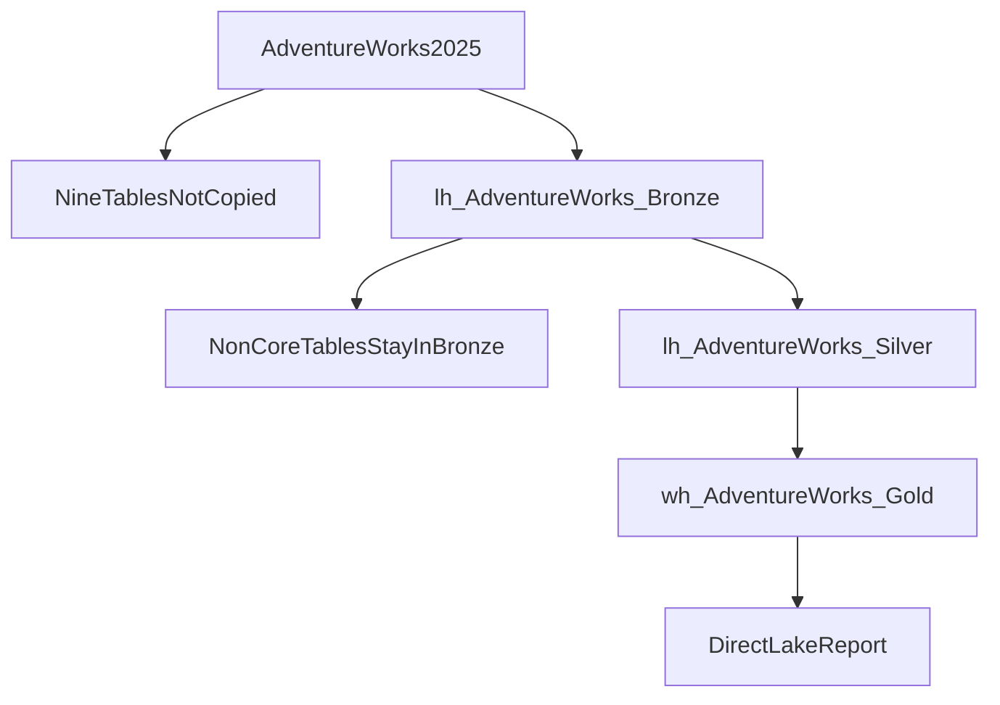
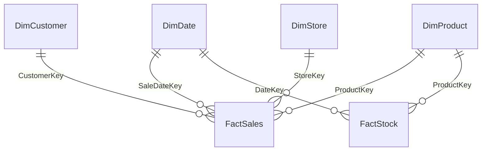

# Part 1 — Architecture

`AdventureWorks2025` loads into Fabric. Do not load `AdventureWorksDW2025`. Database CDC stays on, with no tables captured. Do not restore the OLTP database.

## Names

- Workspace: the existing empty trial workspace. Preferred name `ws_AdventureWorks` only if it does not already have one.
- `lh_AdventureWorks_Bronze`, schema-enabled. Schemas match the source.
- `lh_AdventureWorks_Silver`, schema-enabled. Entities in `cleansed`. Logs in `etl`. No `Silver_` prefix.
- `wh_AdventureWorks_Gold`. `FactSales`, `FactStock`, the dimensions, `dbo.ETL_Log`, `dbo.ingest_watermark`, and `dbo.usp_Load_Gold`.
- Pipeline `pl_AdventureWorks_Medallion`. Notebook `nb_silver_load`.
- Gateway connection: the existing `fabric_user` connection. No credentials in this repo.

Banned names: `Person.Contact`, `Sales.Individual`, `CustomerAddress`, `EmployeeAddress`, `StoreContact`, `VendorContact`, `ContactCreditCard`, `Employee.ManagerID`, and `Sales.Customer.CustomerType`.

## Ingestion

`pl_AdventureWorks_Medallion` runs a Lookup of [ingest_control.sql](../sql/source/ingest_control.sql) against SQL Server through the gateway, then a ForEach with one Copy activity. Batch count 4. Stop on the first failure. Retry 2, 30 seconds, timeout 15 minutes. No staged copy and no partitioned copy.

Parameters: `RunMode` (`Full` or `Incremental`, default `Full`), `WatermarkOverride` (empty), `CoreOnly` (default false). Manual trigger. Do not schedule it.

`Full` uses sink Overwrite. `Incremental` adds `ModifiedDate` greater than the watermark and uses sink Upsert on the primary key, and only for `Sales.SalesOrderHeader` and `Sales.SalesOrderDetail`. The watermark lives in `dbo.ingest_watermark`.

## Bronze

69 base tables. These nine are absent from the Lookup result:

- `cdc.captured_columns`, `cdc.change_tables`, `cdc.ddl_history`, `cdc.index_columns`, `cdc.lsn_time_mapping`
- `dbo.AWBuildVersion`, `dbo.sysdiagrams`, `dbo.systranschemas`
- `Person.Password`

The control query serializes geography to WKT plus SRID, `hierarchyid` to string, `xml` to `nvarchar(max)`, and alias types to their base types. `varbinary`, `binary`, and `image` are not selected. `ProductInventory` is copied and is not core.

## Silver

One Runtime 2.0 notebook. V-Order on. No partitioning, Z-order, or liquid clustering.

Core inputs are the sales header and detail, customer, store, territory, product and its category, subcategory, cost history, and unit of measure, both transaction tables, and the person, phone, email, and address tables. `cleansed.Date` is a generated calendar.

`etl.quarantine`, `etl.dq_result`, and `etl.load_log` record rejects, checks, and row counts.

## Gold

`dbo.usp_Load_Gold` writes every Gold table in one transaction. Primary keys and foreign keys are declared `NOT ENFORCED`. The unknown member is `-1`.

`FactSales` is one row per `SalesOrderDetail`. `SaleKey` is a surrogate. `OrderID` is `SalesOrderID`. `OrderLineID` is `SalesOrderDetailID`.

- `Qty` = `OrderQty`
- `UnitPriceDiscount` is a rate
- `GrossPrice` = `UnitPrice * Qty`
- `NetPrice` = `UnitPrice * Qty * (1 - UnitPriceDiscount)`
- `Tax` and `Freight` are allocated by the line's share of header `SubTotal`. A zero subtotal keeps both amounts on the first line.
- `StandardCost` is `ProductCostHistory` as of `OrderDate`, else `Product.StandardCost`
- `SaleDateKey` is `OrderDate`

Total sales is `NetPrice`. Average selling price is `NetPrice / Qty`. Top 10 and bottom 10 products rank on `NetPrice`.

`DimCustomer` is a person: account number, title, first, middle, last, suffix, one phone and its type, one email, one address, spatial location as WKT, and the customer's sales territory. Address priority is Primary, then Home, then Billing, then Shipping. Tie-break is `AddressID`.

`DimStore` is a store. Address type 3 is Main Office. All 701 stores have that address. Eleven shipping addresses are ignored.

Store-only lines use customer `-1`. Person-only lines use store `-1`. A line for one of the 635 customers who have both a person and a store carries both keys.

`DimDate` uses `DateKey` as `YYYYMMDD`, full date, calendar year, quarter, month number, month name, week of year, day of month, day of year, day of week name, day of week number, `IsWeekend`, and `IsWeekday`.

`DimProduct` carries name, color, category, subcategory, size, weight, size unit, weight unit, class, style, discontinued when `DiscontinuedDate` is not null, and source `ModifiedDate`.

`FactStock` is one row per product per day. The source is `TransactionHistory` union `TransactionHistoryArchive`. `TransactionType = W` is ignored. There is no `DimLocation`.

- `PurchaseQty` = `P` on that day
- `SalesQty` = `S` on that day
- `OpeningQty` = purchases minus sales for every date before that day. The first day opens at 0.
- `ClosingQty` = `OpeningQty + PurchaseQty - SalesQty`

For a selected period, do not sum opening or closing across days. Opening stock is `OpeningQty` on the first selected date. Purchases and sales are the sums inside the period. Closing stock is opening plus purchases minus sales.

These names are the purchase-and-sales balance. The report must not call them the quantity on the shelf. `ProductInventory` is not used. Shelf quantity matches the full movement total for 0 of 432 products.

`dbo.ETL_Log` and `dbo.ingest_watermark` are not in the semantic model. Direct Lake on OneLake. `DimDate` is the date table.
